# Plan: phase 8, real pages and shareable links

Status: APPROVED (2026-10-01). The three questions are answered at the end,
and the approval added these:

- **PR 1 redirects `?tour=` and `?destination=` in the browser**, so old
  links work before PR 2's server redirects exist (see Routes).
- **Route-based code splitting:** Leaflet and the map code load only on
  pages that show a map. The bundle size per page type is reported in the PR
  (see Code splitting).
- **Focus moves to the page's `<h1>` on every route change** (see Back
  button and scroll position).
- **In PR 2, a filtered `/destinations?category=…` uses `/destinations` as
  its canonical URL** (see Canonical URLs).

Today the public site is one page (`/`), with tours, destinations and
articles opening as modals, and anything else redirecting to `/`. Phase 8
gives each tour, destination, experience and article its own URL, adds list
pages, an About page and a real 404. Express fills in each page's title,
description and share-preview tags before sending, so a link pasted into
WhatsApp or Facebook previews the right page.

The screenshots below are **mock-ups**: throwaway pages built from the
existing components, fonts and colours, with the seeded content. They were
made in a scratch worktree and are not part of this commit. Nothing is built
until the plan is approved.

## Routes

| Path | Page | Status when missing |
|---|---|---|
| `/` | Home, unchanged, including the map | |
| `/destinations` | All destinations, category filter (`?category=Beaches`) | |
| `/destinations/:slug` | One destination | 404 |
| `/experiences` | Featured experiences, then the experience categories | |
| `/experiences/:slug` | One featured experience | 404 |
| `/tours` | All tours | |
| `/tours/:slug` | One tour, with its itinerary and route map | 404 |
| `/journal/:slug` | One article | 404 |
| `/about` | About, Why us, and Contact (`#contact`): details and the enquiry form | |
| anything else | The 404 page | 404 |

Details:

- **Slugs are the existing ids** (`ella`, `island-in-7-days`). They are
  already permanent once saved, so no migration is needed. An unpublished
  row is a 404, exactly like a missing one.
- **Old links redirect** (the phase-8 note in `CLAUDE.md`):
  - `/?tour=<id>` gets a 301 to `/tours/<id>`;
  - `/?destination=<id>` gets a 301 to `/destinations/<id>`.

  The WhatsApp links already shared keep working. An id that no longer
  exists lands on its 404.

  **PR 1 does this in the browser:** a loader on the `/` route redirects
  (replacing the history entry) before anything renders. PR 2 adds the
  server's 301, which also serves link previews and crawlers.
- **A trailing slash** (`/tours/`) gets a 301 to the same path without it.
- **No `/journal` index.** It wasn't asked for. The breadcrumb's "Journal"
  goes to the home page's journal section (`/#journal`), so the section gets
  an `id` (an attribute only). An index page is a small follow-up if wanted.

## The pages (mock-ups)

Every page shares the site's layout: the Navbar, a full-bleed image header
with a breadcrumb, the Footer, the WhatsApp button and the enquiry modal.
The fonts, colours, badges and cards are the existing ones.

Full-page captures, so the fixed WhatsApp button appears wherever the
viewport sat. On `/about`, the counters were caught mid-count.

### `/destinations/:slug` (from the destination modal's content)

The modal's content, laid out as a page:

- the header, with the rating and region chips;
- the gallery strip;
- About, quick facts, Google Maps and the airport time;
- must-do experiences and highlights;
- a sticky "Plan a trip" card;
- new below: **Tours through Ella** (from the tour stops) and **More places
  to discover**.

| Desktop | Phone |
|---|---|
| 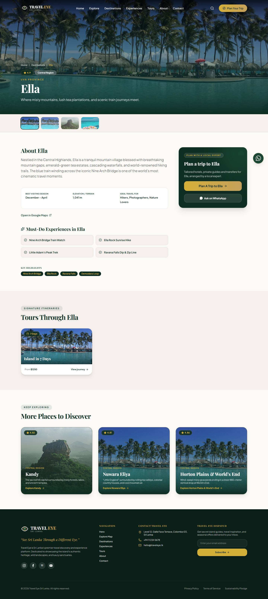 |  |

### `/tours/:slug`

- the overview and highlights;
- **the route**: the route chips, plus a map with the home map's numbered
  stops and dashed line, framed to fit;
- the day-by-day itinerary;
- a sticky price card with "Book / Inquire This Tour";
- other journeys.

| Desktop | Phone |
|---|---|
| 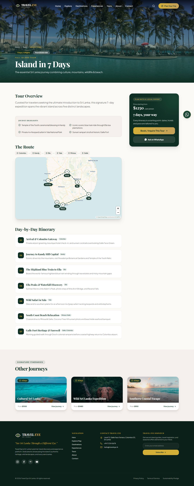 |  |

### `/experiences/:slug`

- a facts row: duration, best time, location, category;
- the description and highlights;
- "Where it happens", linking to the destination when the location names
  one;
- the plan card;
- more experiences.

| Desktop | Phone |
|---|---|
| 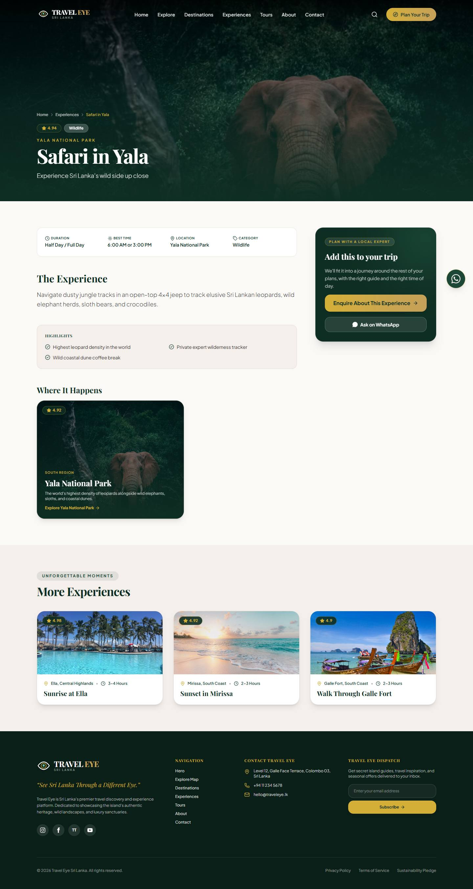 | 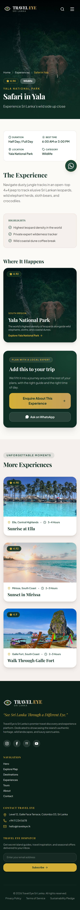 |

### `/journal/:slug` (from the article reader modal)

- the author row;
- the standfirst, then the article text, in a reading column;
- more from the journal.

| Desktop | Phone |
|---|---|
| 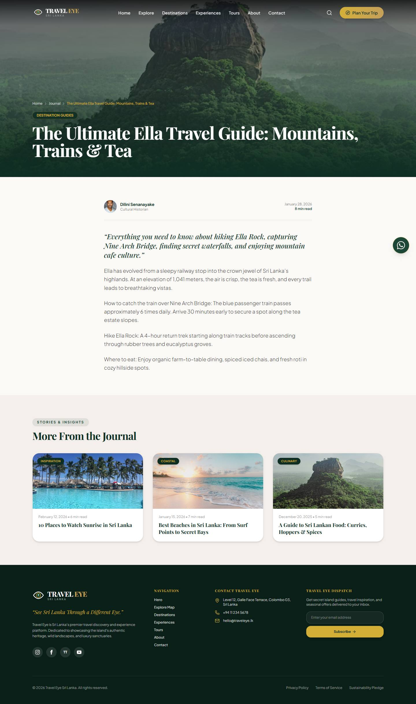 | 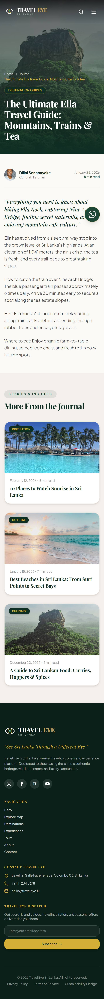 |

### `/destinations`

All published destinations, not just the six featured, with the map's
category chips as a filter. The filter is kept in the URL, so a filtered
list can be shared.

| Desktop | Phone |
|---|---|
| 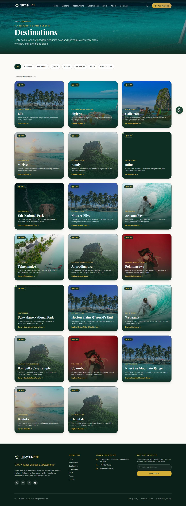 |  |

### `/experiences`

The home page's two experience sections, as they are. On this page, a
category card goes to `/destinations?category=<that category>`. On the home
page it still filters the map.

| Desktop | Phone |
|---|---|
| 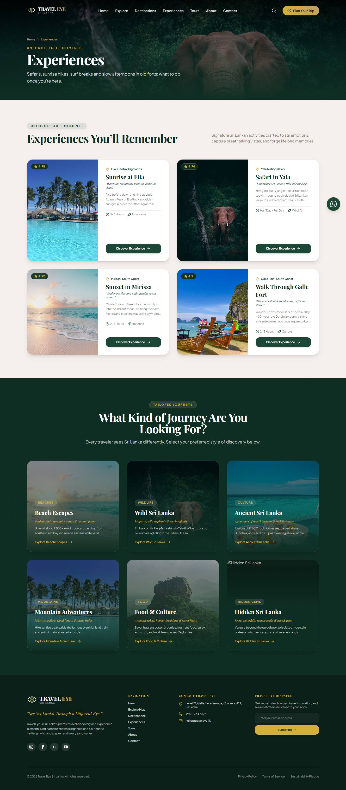 |  |

### `/tours`

The home page's tour cards, as they are. "View Full Journey" goes to the
tour's page. "View route on map" goes to `/#explore-map` with the route
shown.

| Desktop | Phone |
|---|---|
| 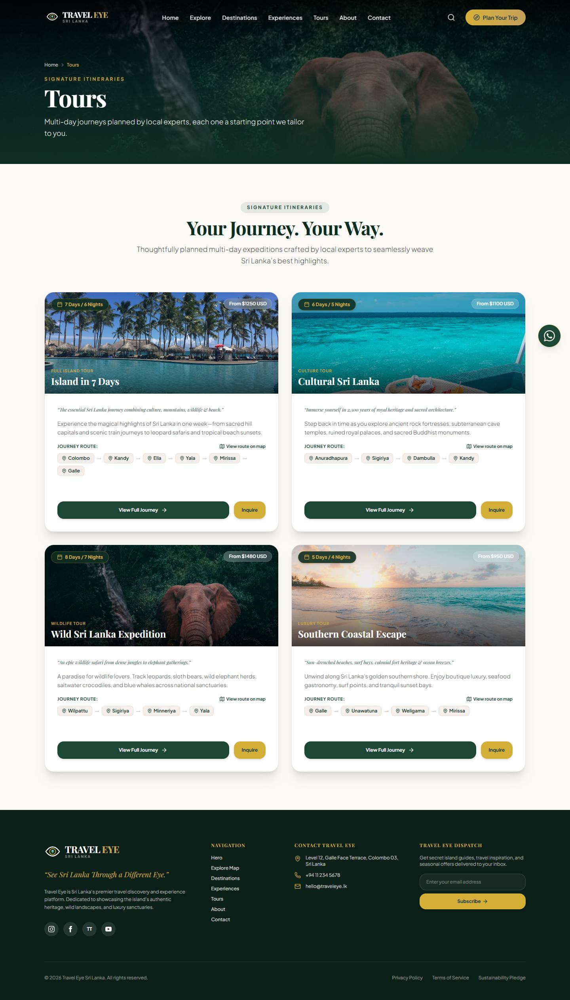 | 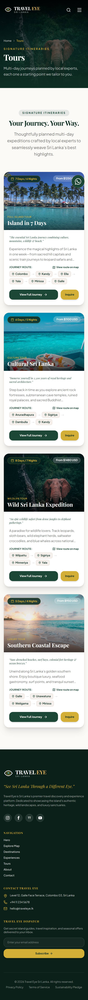 |

### `/about`

- the home page's intro (`IntroSection`) and "Why" (`WhyTravelEye`)
  sections, unchanged;
- then **Contact** (`#contact`): the contact details from Settings
  (including WhatsApp) beside the enquiry form, inline.

The form is the enquiry modal's form, extracted into `InquiryForm` and used
by both, so there is one form and one submit path.

| Desktop | Phone |
|---|---|
| 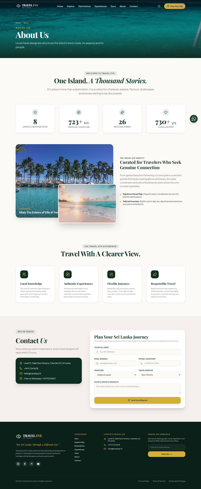 |  |

### 404

A dark header that keeps the Navbar readable, three ways back (Home,
Destinations, Tours), and three featured destinations. Served with HTTP 404.

| Desktop | Phone |
|---|---|
| 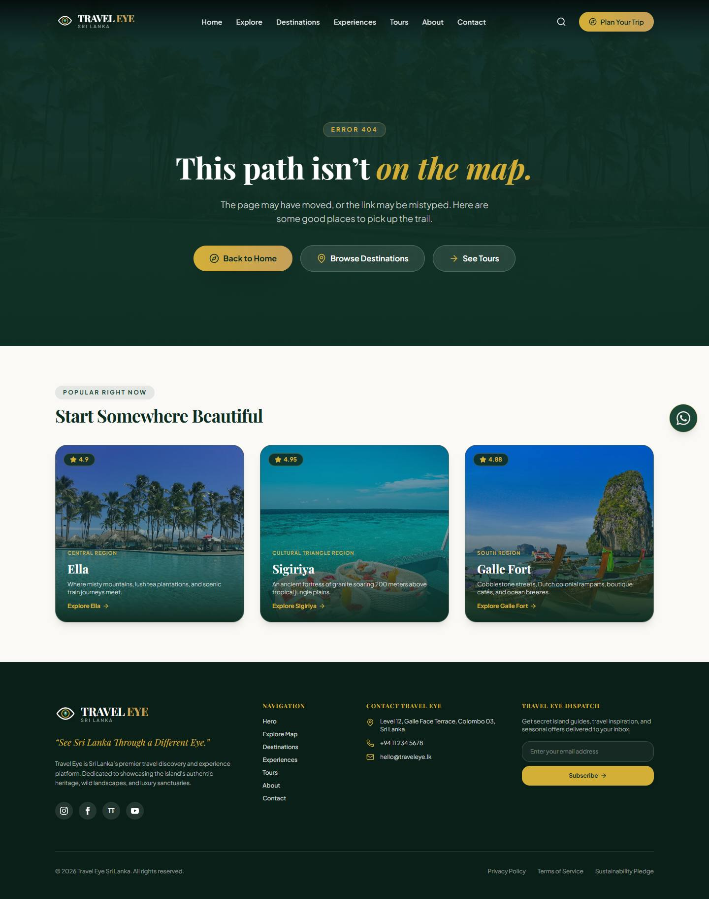 | 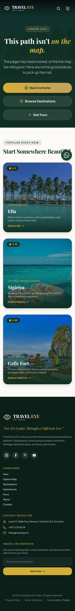 |

**New copy.** The headers' one-line subtitles, "Plan with a local expert",
the 404 text, and "About Us" / "Contact Us". None of it contains the brand
name. Where a page needs the brand, it reads it from `shared/brand.ts` (see
Sharing and SEO).

## Behaviour

### Retire `DestinationModal` (and the tour and article modals)

**Recommended: retire all three.** Every "Explore", "View Full Journey" and
"Read story" goes to the page. Why:

- **The map already has a quick preview.** Its side panel (desktop) and
  mobile card show the photo, description, Google Maps link and airport
  time. A modal on top of that preview is a third copy of the same content.
- **A modal can't be shared or bookmarked**, and the back button skips over
  it. Those are the two things this phase is for.
- **One copy of each layout to keep right.** The modal and the page would
  drift, and each new field would have to be added twice.

Kept: the hidden-gem modal (hidden gems have no pages), the search modal and
the enquiry modal.

### Links

- **Navbar, desktop and the mobile menu**, as real `<a href>` (React
  Router's `Link`), so new-tab, middle-click and crawlers all work:

  | Label | Goes to |
  |---|---|
  | Home | `/` |
  | Explore | `/#explore-map` (scrolls to the map) |
  | Destinations | `/destinations` |
  | Experiences | `/experiences` |
  | Tours | `/tours` |
  | About | `/about` |
  | Contact | `/about#contact` (scrolls to the form) |

- **The logo** goes to `/`. "Plan Your Trip" still opens the enquiry modal.
- **Footer navigation:** the same seven targets (see question 1 about its
  labels).
- **Cards:**
  - spotlight destinations, featured experiences, tour cards ("View Full
    Journey") and journal cards link to their pages;
  - the map's "Explore Ella" (side panel and mobile card) links to the
    destination page;
  - search results navigate to the destination page.
- **Stays on the home page:** the hero's buttons, the CTA's "Explore Sri
  Lanka", the experience-category cards (they filter the map), "Inquire",
  and "View route on map".

### Back button and scroll position

- **The router becomes a data router** (`createBrowserRouter`), for React
  Router's `<ScrollRestoration>`:
  - a new page opens at the top;
  - Back and Forward return to where you were. Back from a tour page to the
    middle of the home page lands on the card you clicked.
- **Hash links** (`/#explore-map`, `/about#contact`) scroll to their section
  once the content has loaded. The home page waits for content before
  painting, so a plain `scrollIntoView` on navigation would run too early.
- **On the home page, the section links scroll smoothly** and *replace* the
  hash rather than pushing it. Clicking Explore three times doesn't take
  three Backs to leave the page.
- **Page changes are announced.** On every route change (not the first
  load), focus moves to the new page's `<h1>`, with `preventScroll`, so it
  never fights scroll restoration. The `<h1>` gets `tabindex="-1"` at that
  moment, from the layout, so the frozen components' markup doesn't change.
  `document.title` updates too. A screen reader hears the navigation, and
  the browser's history menu shows real titles.
- **A hash navigation** (`/#explore-map`, `/about#contact`) focuses the
  section it scrolls to, the same way.

### The enquiry form and the WhatsApp button follow the page

| Page | Enquiry subject (today's formats) | WhatsApp message |
|---|---|---|
| `/tours/:slug` | `<tour title>` | "Hi! I'm interested in the <title> tour. <page URL>" |
| `/destinations/:slug` | `<destination name>` | "Hi! I'd like to know more about visiting <name>. <page URL>" |
| `/experiences/:slug` | `Experience: <title> (<location>)` | **new:** "Hi! I'm interested in the <title> experience. <page URL>" |
| Home, map showing a route | (unchanged) | the tour message, linking to `/tours/<id>` |
| Anything else | General Sri Lanka Trip Inquiry | "Hi! I'd like help planning a trip to Sri Lanka." |

- The page URL is now the canonical URL (`/tours/<id>`), not `?tour=`.
- The WhatsApp button's keep-clear targets move with the content:
  - the pages' main buttons get `data-keep-clear`;
  - the tour page's route map is covered by the existing zoom-button rule.

## Sharing and SEO

### What Express sends for each page

`index.html` keeps its default `<title>` and description between two
markers. For every non-API, non-asset GET, Express resolves the path and
replaces the block between the markers:

```html
<!--page-meta-->
<title>Ella | Travel Eye</title>
<meta name="description" content="Where misty mountains, lush tea plantations, and scenic train journeys meet.">
<link rel="canonical" href="https://<site>/destinations/ella">
<meta property="og:type" content="website">            <!-- "article" for /journal -->
<meta property="og:site_name" content="Travel Eye">
<meta property="og:title" content="Ella | Travel Eye">
<meta property="og:description" content="…">
<meta property="og:url" content="https://<site>/destinations/ella">
<meta property="og:image" content="https://…/ella.jpg">
<meta property="og:image:alt" content="Ella">
<meta name="twitter:card" content="summary_large_image">
<meta name="twitter:title" content="Ella | Travel Eye">
<meta name="twitter:description" content="…">
<meta name="twitter:image" content="https://…/ella.jpg">
<!--/page-meta-->
```

- **Values** come from the row:
  - title and name;
  - `short_description` / `short_desc` / `snippet` / `description`,
    trimmed to about 160 characters on a word boundary;
  - the row's image.

  The list pages, About and the 404 have fixed text. Every value is
  HTML-escaped.
- **Share images:** Unsplash URLs get `w=1200&h=630&fit=crop` (the size
  WhatsApp and Facebook prefer). R2 images go as they are. Pages without an
  image use the first hero slide.
- **The 404 and `/admin/*`** also get `<meta name="robots" content="noindex">`.
  `/admin/*` also gets an `X-Robots-Tag: noindex` header.
- **One lookup per request:** a primary-key read of one published row, so
  no list is loaded and nothing is cached. An admin edit changes the very
  next preview.
- **The page body isn't server-rendered**, only the head.
  - Link previews and crawlers that read the head are fully served.
  - Google renders the JavaScript for the body.
  - Full server rendering is a much bigger change, and isn't needed for any
    goal here.
- **The CSP is unchanged.** These are `<meta>` and `<link>` tags; nothing
  runs or loads. Structured data (JSON-LD) would need an inline script and a
  CSP hash, so it is out of scope.

### One place for names, paths and titles

- **`shared/brand.ts`:** `BRAND_NAME = 'Travel Eye'` and the tagline. These
  are the existing strings, moved, not new ones.
  - The page titles, `og:site_name` and the default title read them.
  - Vite injects them into `index.html` at build time.
  - Renaming the brand changes one file for every title. The rename itself
    is still launch item 17.
- **`shared/site-paths.ts`:** `paths.tour(id)` and friends. The links, the
  server's resolver, the sitemap and the WhatsApp messages all build URLs
  with them.
- **`shared/page-meta.ts`:** pure functions from a row to
  `{ title, description, image, path }`. Express uses them for the head, and
  the client uses them for `document.title` on navigation, so the two never
  disagree.

### Canonical URLs

A filtered list (`/destinations?category=Beaches`) uses the unfiltered
page, `/destinations`, as its canonical URL, so search engines see one list
page, not eight.

The site origin comes from `PUBLIC_SITE_URL`, which is today read only for
the enquiry emails. It will be read on its own.

- Unset (local, tests, and production until the domain exists), the
  request's origin is used, with `trust proxy` as now.
- Launch checklist item 8 gains "set `PUBLIC_SITE_URL` to the domain", so
  canonical links and the sitemap never depend on a request's `Host`.

### `sitemap.xml` and `robots.txt`

Both are built per request from the database, with `Cache-Control: no-cache`.

- **`/sitemap.xml`:**
  - `/`, `/destinations`, `/experiences`, `/tours` and `/about`;
  - plus every **published** destination, experience, tour and article,
    with `<lastmod>` from its `updated_at`;
  - absolute URLs, XML-escaped.
- **`/robots.txt`:**
  ```
  User-agent: *
  Disallow: /admin
  Disallow: /api/
  Sitemap: https://<site>/sitemap.xml
  ```

## Code splitting

- **Route-based:** each page is its own chunk, loaded by the route's `lazy`.
  With the data router, the current page stays on screen until the next
  one's code has arrived, so there is no blank flash between pages.
- **The map code** sits only in the chunks of the pages that show a map:
  - `InteractiveMapSection` and the marker module in the home page's chunk;
  - `RouteMap` in the tour page's chunk.
- **Leaflet itself** (JS and CSS) loads only when a map is about to render:
  - the JS by dynamic `import('leaflet')`, as today;
  - the CSS from the same unpkg URL and SRI hash as today, but inserted by
    the map loader (`src/lib/leaflet.ts`) instead of `index.html`, and
    placed before the site's own stylesheet so the cascade is unchanged.
  - The admin's stops editor uses the same loader.
  - The CSP is unchanged: unpkg is already allowed for styles.
- **`npm run bundle:report`** reads Vite's manifest and prints the gzipped
  JS and CSS each page type loads. The PR reports it.

## Admin edits show up on the next load

- **HTML:** `index.html` is sent `no-cache` (as now), and its head is built
  from the database per request.
- **Content:** `/api/content` stays `no-cache` with an ETag (as now).
- **Client navigation:** the public content query is revalidated in the
  background on **every client-side navigation**, not just page loads. An
  unchanged payload is a 304, so this is cheap. Today it is fresh for five
  minutes, which an in-app page change wouldn't reset.
- **Sitemap and robots.txt:** per request, `no-cache`.
- **Admin:** the editor for each of the four tables gets a "View page" link
  to the record's page (opens in a new tab).

## Changes to frozen files (`src/components/`), called out

The home page must still render exactly as it does today. Cards that become
links keep their classes. A `flex` or `grid` `<a>` lays out like the `div`
it replaces, and Tailwind's base styles already remove link colour and
underline. A before/after pixel comparison of the home page is in the
tests.

| File | Change | Visible? |
|---|---|---|
| `Navbar.tsx` | buttons become `Link`s to the routes above; the mobile menu closes on navigation | no |
| `Footer.tsx` | the navigation list becomes `Link`s | no, unless question 1 says rename |
| `DestinationSpotlight.tsx` | each card is a `Link` | no |
| `FeaturedExperiences.tsx` | card and "Discover Experience" link to the page (today they open the enquiry form) | no |
| `ToursSection.tsx` | "View Full Journey" is a `Link`; the detail modal is removed (and with it #6's `selectedTourId` props) | no |
| `JournalSection.tsx` | cards are `Link`s; the reader modal is removed; the section gets `id="journal"` | no |
| `InteractiveMapSection.tsx` | "Explore <name>" (panel and mobile card) is a `Link` | no |
| `SearchModal.tsx` | a result navigates to the destination page | no |
| `ExperiencesSection.tsx` | optional `categoryHref`: on `/experiences` a card links to the filtered list | no |
| `InquiryModal.tsx` | the form moves into `InquiryForm.tsx`; the modal wraps it | no: `browser-inquiry.test.ts` still compares against `faed6bc` |
| `DestinationModal.tsx` | **deleted** | |
| **new** `PageHero.tsx`, `PlanCard.tsx`, cards, `RouteMap.tsx`, `NotFound.tsx` and the page components | the pages above | yes, new pages |

`src/pages/PublicSite.tsx` splits into:

- `PublicLayout` (Navbar, Footer, modals, WhatsApp button);
- `HomePage` (the sections, unchanged);
- one file per page.

Its `?tour=` / `?destination=` handling moves to the server's redirects.

## Tests

- **Server, routing** (`server/test/pages.test.ts`):
  - each route answers 200 with the shell;
  - unknown paths, unknown slugs and **unpublished** slugs answer **404**
    with the shell and `noindex`;
  - `/api/*` is still a JSON 404;
  - `/?tour=` and `/?destination=` get a 301 to the page;
  - a trailing slash gets a 301;
  - `HEAD` matches `GET`.
- **Server, head tags:** for one row of each kind, plus the list pages,
  About and the 404:
  - the exact `<title>`, description, canonical, `og:*` and `twitter:*`;
  - a title containing `" < > &` comes out escaped;
  - **editing the row changes the next response** (no caching);
  - `PUBLIC_SITE_URL` wins over the request's host.
- **Sitemap and robots:**
  - every published row and static page appears, with absolute URLs and
    `lastmod`;
  - an unpublished row does not;
  - the XML is well formed and escaped;
  - robots.txt disallows `/admin` and `/api/` and names the sitemap.
- **Chrome** (`server/test/browser-pages.test.ts`):
  - **the links are real:** the nav links have the right `href` (desktop and
    mobile menu), and clicking a card, "Explore Ella" or a search result
    lands on its page;
  - **Back** from a tour page restores the home scroll position, and a new
    page opens at the top;
  - **hash links:** "Explore" from `/tours` lands on the map, and "Contact"
    lands on the About page's form;
  - **the 404 page** renders for a bad slug;
  - **pre-fill:** the enquiry subject and the WhatsApp link are right on the
    tour, destination and experience pages;
  - `document.title` follows navigation.
- **Existing tests:**
  - **Updated** for the retired modals: `browser-routes` uses the
    destination page for the Google Maps link checks; `browser-whatsapp`
    uses pages and the redirects.
  - The CSP test also walks one page of each type, and still reports zero
    violations.
  - `browser-inquiry` against `faed6bc` is unchanged.
- **The home page:** a pixel comparison against `main` before this phase
  (`bf94e25`), like `browser-inquiry`'s
  (`server/test/browser-home-baseline.test.ts`).
  - Each home section this phase changes is rendered twice, side by side in
    headless Chrome with the built CSS: once from `bf94e25` (read with
    `git show`) and once from now. No pixel may differ beyond the tolerance.
  - Covered: the Navbar, spotlight cards, featured experiences, tour cards,
    experience categories, journal cards and the search modal, at desktop
    and phone widths.
  - Images are replaced by a solid placeholder and the test runs offline, so
    nothing depends on the network.
  - **The Footer is left out**, because question 1 changes its labels on
    purpose; its before/after screenshots are in the PR.
  - **So is the map section:** its only change is "Explore <name>" becoming
    a link, which the Chrome tests check, and its tiles need the network.
  - The demo-baseline review stands.

## Delivery

Two PRs, each deployable on its own:

1. **8a: pages and links.** Router, layout, pages, links, modals retired,
   scroll behaviour and focus, pre-fill, the client-side 404, the browser
   redirects for `?tour=` / `?destination=`, code splitting, page titles,
   and the admin's "View page" links. Screenshots of every page as built,
   and the bundle report.
2. **8b: server side.** Head tags, 404 status, redirects, sitemap and
   robots, and `PUBLIC_SITE_URL`.

Each one runs `typecheck`, `build`, `npm test` and `verify:roundtrip`, then
opens a PR and stops when CI is green.

## Questions (answered: all as recommended)

The questions as asked, kept for the record. The answers are 1 yes, 2 yes,
3 yes; for 3, PR 2 also gives filtered lists `/destinations` as their
canonical URL.

1. **Footer labels.** The Footer's navigation reads "Hero", "Explore Map",
   …, "Contact" (made from section ids). Keep them (no visible change), or
   use the Navbar's labels ("Home", "Explore", …)? **Recommended: the
   Navbar's labels.** "Hero" means nothing to a visitor. It is a visible
   change to the Footer.
2. **The plan card on phones.** In the mock-ups it comes after the page's
   content. Alternatively it could sit right under the first paragraph, so
   the call to action is reached sooner. The WhatsApp button is always
   there either way. **Recommended: after the content, as shown.**
3. **Experience-category cards on `/experiences`** link to
   `/destinations?category=<category>`. On the home page they keep
   filtering the map. **Recommended: yes.** The alternative is
   `/#explore-map` with the filter set, which leaves the page.

## As built (8a): differences from this plan

- **`BrowserRouter`, not the data router.** Measured on the built bundle,
  `createBrowserRouter` put 157.0 KB (gzipped) of JS in the entry every page
  loads, against 137.3 KB with `BrowserRouter`: about 20 KB on every page,
  for the one feature the plan wanted from it, `<ScrollRestoration>`. So:
  - **Scroll restoration** is `src/lib/ScrollRestorer.tsx` (about 60
    lines). It records positions as the page scrolls, by history entry, and
    restores them on Back and Forward; a new page opens at the top.
  - **Pages are `React.lazy` chunks.** Navigations run in a transition, so
    the current page stays up until the next one's code arrives, as the
    plan wanted. Only a page's very first load shows a blank area in place
    of the page, under the Navbar.
  - **The old-link redirect** is `HomeRoute` (`<Navigate replace>`) instead
    of a route loader. Same behaviour, tested.
- **`<body data-route>`.** Because of the transition, the URL changes a
  moment before the page does. The layout stamps the path of the page
  actually on screen on `<body>`; the tests wait on it.
- **`scroll-smooth` is gone from `<html>`.** It made the restored position
  animate (Back visibly scrolled down from the top). Every in-page scroll
  already asks for smooth scrolling itself.
- **Section links focus their section too**, not only after a navigation:
  the hero's buttons and a Navbar link to a section of the current page.
- **The plan card** also has "Ask on WhatsApp" (the page's pre-filled
  chat) when a number is set. Both its buttons, and the inline enquiry
  form's submit button on `/about`, are `data-keep-clear`.
- **"View page"** in the admin editor shows only for a published row (an
  unpublished one has no page).
- **The destination page's thumbnails** swap the header photo, as they did
  in the modal.
- **The Footer test and the map**: as planned, the pixel comparison
  (`browser-home-baseline`) leaves both out. The test suite's 60 s limit
  also applies to a `describe` block, so that suite sets its own 5 minutes.

### Bundle size per page type (gzipped, `npm run bundle:report`)

Before phase 8 the site was one page, loading 157.4 KB of JS and 11.3 KB of
CSS, plus Leaflet's 42.5 KB once the map neared the viewport.

| Page type | JS on load | CSS on load | Map, on demand |
|---|---:|---:|---:|
| Home | 163.9 KB | 11.5 KB | + 42.5 KB (Leaflet) |
| Destinations list | 142.8 KB | 11.5 KB | — |
| Destination | 146.8 KB | 11.5 KB | — |
| Experiences list | 142.8 KB | 11.5 KB | — |
| Experience | 145.6 KB | 11.5 KB | — |
| Tours list | 142.3 KB | 11.5 KB | — |
| Tour | 147.9 KB | 11.5 KB | + 42.5 KB (Leaflet) |
| Article | 143.8 KB | 11.5 KB | — |
| About | 146.1 KB | 11.5 KB | — |
| 404 | 141.8 KB | 11.5 KB | — |
| Admin | 223.0 KB | 11.5 KB | — |

The entry every public page shares is 138.5 KB of JS. Leaflet's
stylesheet (unpkg) comes with its JS and isn't counted.
